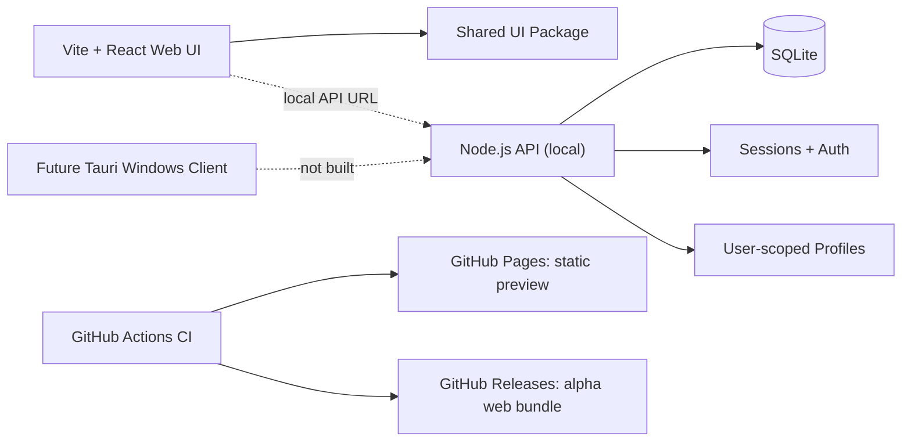

# DMA HUB

**Professional Hybrid • Software & Device Management Platform**

[](https://github.com/migtam628/dma_hub/actions/workflows/ci.yml)
[](https://github.com/migtam628/dma_hub/actions/workflows/pages.yml)
[](https://github.com/migtam628/dma_hub/actions/workflows/release.yml)
[](https://github.com/migtam628/dma_hub/actions/workflows/desktop.yml)

> **Status: public alpha / active development.** The web UI runs with sample data. The local API supports accounts and versioned profile storage, but is **not yet production hardened**. There is **no signed Windows executable, live billing, working license service, or hardware control** in the published alpha. A Tauri desktop build workflow exists on `main`, but Windows installers are **unsigned preview artifacts** until verified and signed. Demo screens are not proof of connected services.

**[Web preview — GitHub Pages](https://migtam628.github.io/dma_hub/)** · **[Releases](https://github.com/migtam628/dma_hub/releases)** · **[Actions](https://github.com/migtam628/dma_hub/actions)** · **[Roadmap](docs/project-roadmap.md)**

The Pages link works **after GitHub Pages has been enabled and the Pages deployment succeeds**. If not yet active, see [Enable GitHub Pages](#publishing-github-pages).

## Overview

DMA Hub is a modular, permission-first platform for discovering software, configuring supported tools, storing profiles, distributing releases, and monitoring devices with documented interfaces. The approved **Concept 3 — Professional Hybrid** design uses midnight navy, cyan actions, and restrained violet accents.

| Area | Current status | What's included |
|---|---|---|
| Public website | ✅ Web preview | Homepage, product catalog, search, filters, details, guides |
| Customer workspace | ✅ Web preview | My Software, device list, subscription placeholder, support, status |
| Admin workspace | ✅ Synthetic preview | Users, products, releases, system readiness |
| Configuration Studio | ✅ Local functionality | Edit settings, live preview, JSON import/export, browser storage |
| API | 🧪 Local alpha | Account registration, login/logout, tenant-scoped versioned profiles |
| Cloud profiles | 🧪 Local API | Create, load, update, delete, optimistic version checks |
| Desktop companion | 🧪 Windows scaffold | Tauri shell source, NSIS build CI, launcher and diagnostics previews; no hardware APIs |
| Device adapters | ⏳ Planned | User-authorized USB/serial/HID/network integrations |
| Payments/licensing | ⏳ Not connected | Real billing, entitlement verification, audit and recovery |
| Public hosting | ⚙️ Automated workflow | GitHub Pages for static preview **only** |

### Screens

| Website | Customer | Admin | Launcher & Studio |
|---|---|---|---|
| Home | Dashboard | Overview | Launcher UI preview |
| Product catalog | My Software | Users & Licenses | Device Center preview |
| Product details | Cloud Profiles | Product Management | Diagnostics preview |
| Hardware & Partners | Devices & Downloads | Release Center | Local settings editor |
| Documentation & Status | Billing preview | Service Readiness | Export/import profiles |

All demos mark simulated data and unavailable operations. Product names and logos in planning references do not imply affiliations or verified integrations.

## Architecture



**Important:** GitHub Pages is static hosting, not an API host. Don't publish the local API's SQLite database or environment files to Pages.

### Technology

- React 19, TypeScript, Vite 6, Tailwind CSS 4, lucide-react
- npm workspaces with `apps/web`, `apps/api`, `packages/ui`
- Local API: Node.js 22+, `node:http`, `node:sqlite`, scrypt password hashing and hashed opaque session tokens
- Continuous integration: GitHub Actions for build, source tests, API tests and type checking
- Hosting: static site via GitHub Pages, planned separate backend hosting
- Planned desktop: Tauri with Rust native device adapter layer

### Repository map

```text
dma_hub/
├── apps/
│   ├── web/               # React web preview
│   │   └── src/
│   └── api/               # Local-development HTTP + SQLite API
│       ├── src/
│       └── tests/
├── apps/desktop/           # Tauri 2 Windows shell and native build configuration
├── packages/
│   └── ui/                # Shared visual components and tokens
├── docs/                  # Three specification batches, designs, API docs
├── release/               # Version manifest + release notes
├── tests/                 # Repository integrity checks
└── .github/workflows/
    ├── ci.yml             # Test and build on pushes
    ├── pages.yml          # Deploy static web preview
    ├── release.yml        # Build and publish alpha ZIP/checksum
    └── desktop.yml        # Build unsigned Windows NSIS preview artifact
```

## Quick start

**Prerequisites:** Node.js 22 or later (Node 22.13+ for the built-in `node:sqlite` API), npm, Git.

```bash
git clone https://github.com/migtam628/dma_hub.git
cd dma_hub
npm install
npm run check
```

### Start the public UI

```bash
npm run dev
```

Open the local URL printed by Vite, normally `http://localhost:5173/`. The default browser preview works without the backend; browse `#/dashboard` or `#/studio`.

### Start the local-development API

In another terminal in the repo root:

```bash
npm run dev:api
```

Defaults:

- HTTP address: `http://127.0.0.1:8787` (loopback only).
- Browser API requests: `http://localhost:8787` in development.
- Database: SQLite under `apps/api/data/` or the process working directory's `./data/`.
- CORS allowlist: `http://localhost:5173` (set `WEB_ORIGIN` to your actual frontend origin).

Use the Account view to register a **development-only** account and test profile syncing. The session token is kept in page memory rather than browser localStorage; page refresh signs you out. Never reuse a production password.

```bash
# Local readiness check
curl http://127.0.0.1:8787/healthz

# Frontend production bundle
npm run build
```

See [API reference](docs/api.md) for endpoints, authorization and limitations.

## Publishing GitHub Pages

The `pages.yml` workflow builds `apps/web` and uploads `apps/web/dist` to GitHub Pages. It runs on changes to the frontend/workflow and may also be started manually from Actions.

**Current blocker:** GitHub Pages was not enabled when the initial workflow ran. Its build passed, but the Pages configuration action returned `Not Found`. Track activation in [issue #1](https://github.com/migtam628/dma_hub/issues/1).

**One-time GitHub repository setting:**

1. Visit [Settings → Pages](https://github.com/migtam628/dma_hub/settings/pages).
2. Under **Build and deployment**, set **Source → GitHub Actions**.
3. Open [Deploy GitHub Pages](https://github.com/migtam628/dma_hub/actions/workflows/pages.yml) and use **Run workflow** if no successful deployment is visible.
4. Once the deployment succeeds, visit **https://migtam628.github.io/dma_hub/**.

The preview uses hash navigation and relative Vite asset URLs for correct project-site hosting at `/dma_hub/`. **No server-side login, API, or payment service is hosted on Pages.**

## GitHub Releases

[All releases](https://github.com/migtam628/dma_hub/releases) · [Alpha 2](https://github.com/migtam628/dma_hub/releases/tag/v0.2.0-alpha.2) · [Release workflow](https://github.com/migtam628/dma_hub/actions/workflows/release.yml)

Versioned releases are triggered by changes to `release/version.json` on `main` or by manual workflow dispatch.

- **v0.2.0-alpha.1** — initial tested static React preview ZIP, checksum and source archive.
- **v0.2.0-alpha.2** — tested web preview bundle, plus a Windows NSIS launcher installer **after its separate Windows release job succeeds**. The Windows artifact is **UNSIGNED**, for testing only.
- Every web bundle has a SHA-256 checksum; a successfully uploaded Windows installer has its own `SHA256SUMS-windows.txt`.
- The release pipeline verifies that a tag belongs to its triggering commit before uploading Windows files. Re-running on an unrelated commit cannot replace artifacts associated with another tag.
- A GitHub prerelease is **not** a production software release. Signing, device QA, updater trust and deployment readiness are separate gates.

To create the next alpha, update `release/version.json` to a unique version and edit `release/notes.md`, then commit and push. The release workflow builds/tests the React project, packages the static site, creates the tag/release, then compiles Windows NSIS on a Windows runner.

### Docker API preview

A separate [Docker Compose guide](docs/deployment.md) describes a **loopback-only** Node/SQLite API container with a named persistent volume, non-root service account, dropped capabilities and health checks.

```bash
docker compose up --build --wait -d api
curl -f http://127.0.0.1:8787/healthz
```

The [API Container Smoke workflow](https://github.com/migtam628/dma_hub/actions/workflows/api-container.yml) verifies that image. This does **not** mean the API is ready for public internet exposure.

## Tests and validation

```bash
npm run typecheck
npm run test
npm run build
npm run check
```

CI runs on pushes to `main` and pull requests. Verify the **Web and API CI** workflow is green before assuming a change is good.

## Security / project boundaries

- No unauthorized access, game-memory extraction, covert device operations or anti-cheat evasion.
- The demo catalog, products and device statuses are synthetic; no service activation is implied.
- Profile writes are owned by an authenticated account and guarded by per-profile version numbers.
- The local API must not be exposed to the public internet without TLS, account verification, migration strategy, secrets handling, abuse limits, backups and independent security review.
- Do not commit passwords, API keys, customer data, SQLite databases, or signing certificates.
- Before commercial launch, add genuine billing/licensing systems, published privacy and support policies, real product compatibility testing and a rollback plan.

## Design handoff and roadmap

- [Concept 3 — Batch 1](docs/concept-3-batch-1.md): public site and customer UX
- [Concept 3 — Batch 2](docs/concept-3-batch-2.md): admin, launcher and Studio
- [Concept 3 — Batch 3](docs/concept-3-batch-3.md): secondary screens and states
- [High-fidelity review v1](docs/design/concept-3-hifi-review-v1.md) and [v2](docs/design/concept-3-hifi-review-v2.md)
- [Roadmap](docs/project-roadmap.md), [API reference](docs/api.md), [Windows desktop build](docs/desktop.md), [Implementation milestone 1](README_IMPLEMENTATION.md)

## Tracking remaining milestones

- [GitHub Pages activation](https://github.com/migtam628/dma_hub/issues/1) — one-time administrator setting.
- [Production API security](https://github.com/migtam628/dma_hub/issues/2) — email verification, backups, abuse protection and deployment review.
- [Signed Windows distribution](https://github.com/migtam628/dma_hub/issues/3) — publisher signatures and trusted updater.
- [First hardware adapter](https://github.com/migtam628/dma_hub/issues/4) — authorized real-device QA.

## Development workflow

Every meaningful implementation milestone should be tested, committed and pushed. The CI, Pages, and release workflows provide independent validation. **A successful workflow is not the same as a production-ready release**; outstanding milestones remain tracked explicitly.

**Project stage:** active alpha. Code, specifications and automated checks exist; the full platform is **not complete**.
