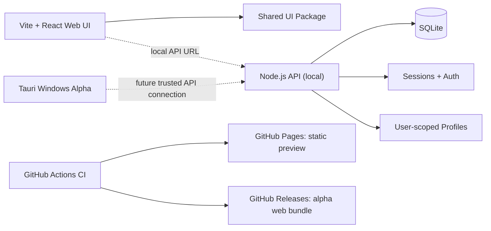

# DMA HUB

**Professional Hybrid • Software & Device Management Platform**

[](https://github.com/migtam628/dma_hub/actions/workflows/ci.yml)
[](https://github.com/migtam628/dma_hub/actions/workflows/pages.yml)
[](https://github.com/migtam628/dma_hub/actions/workflows/release.yml)
[](https://github.com/migtam628/dma_hub/actions/workflows/desktop.yml)

> **Status: public alpha / active development.** The web UI runs with sample data. The local API supports accounts and versioned profile storage, but is **not yet production hardened**. There is **no signed Windows executable, live billing, working license service, or hardware control** in the published alpha. A Tauri desktop build workflow exists on `main`, but Windows installers are **unsigned preview artifacts** until verified and signed. Demo screens are not proof of connected services.

**[DMA Cheats for Games](https://dma.moobee.lol/#/games)** · **[Live site — dma.moobee.lol](https://dma.moobee.lol/)** · **[Downloads](https://dma.moobee.lol/#/releases)** · **[Releases](https://github.com/migtam628/dma_hub/releases)** · **[Actions](https://github.com/migtam628/dma_hub/actions)** · **[Roadmap](docs/project-roadmap.md)**

**Hosting:** GitHub Pages is live with the GoDaddy-managed custom domain `dma.moobee.lol` and Enforce HTTPS. Frontend changes deploy automatically after a successful Pages workflow.

## Overview

DMA Hub is a modular, permission-first platform for discovering software, configuring supported tools, storing profiles, distributing releases, and monitoring devices with documented interfaces. The approved **Concept 3 — Professional Hybrid** design uses midnight navy, cyan actions, and restrained violet accents.

| Area | Current status | What's included |
|---|---|---|
| Public website | ✅ Web preview | Homepage, catalog, setup guides, live GitHub Releases download center |
| Customer workspace | 🧪 Mixed preview | Signed-in users can view API-backed entitlements and create/review **sandbox** orders; other pages remain sample data |
| Admin workspace | 🧪 Mixed preview | Local API admin-only Products editor, Pricing & Test Access, Sandbox Orders, Audit Log and aggregate Security Monitoring; remaining pages are synthetic |
| Configuration Studio | ✅ Local functionality | Edit settings, live preview, JSON import/export, browser storage |
| API | 🧪 Local alpha | Account sessions, SQLite schema v12, durable throttling, optional email verification/recovery, profiles and backup/restore tests |
| Cloud profiles | 🧪 Local API | Create, load, update, delete, optimistic version checks |
| Desktop companion | 🧪 Windows scaffold | Tauri shell source, NSIS build CI, launcher and diagnostics previews; no hardware APIs |
| Device adapters | 🧪 Read-only native serial discovery | Explicit Windows COM-port metadata scan; no port data access or device writes |
| Persistent catalog | 🧪 Local API + UI alpha | Admin-gated versioned product editor, category/features/requirements metadata, published-only searchable catalog/detail pages, and audit records; storefront also labels demo concepts |
| Pricing & entitlements | 🧪 API alpha | USD plans, sandbox orders, expiring test grants, opt-in Stripe **test-mode** Checkout, and v12 admin/customer review APIs; no live payments |
| Payments/licensing | 🧪 Test-only integration | Opt-in Stripe TEST Checkout, signed test webhook observations and manual reconciliation reviews; no live charges, settlement or commercial licensing |
| Public hosting | ✅ Live | `https://dma.moobee.lol` via GitHub Pages; static preview **only** |

### Screens

| Website | Customer | Admin | Launcher & Studio |
|---|---|---|---|
| Home | Dashboard | Overview | Launcher UI preview |
| Product catalog | My Software | Users & Licenses | Device Center preview |
| Product details | Cloud Profiles | Product Management | Diagnostics preview |
| Hardware & Partners | Devices & Downloads | Release Center | Local settings editor |
| Documentation & Status | Billing preview | Service Readiness | Export/import profiles |

All demos mark simulated data and unavailable operations. Product names and logos in planning references do not imply affiliations or verified integrations.

## Architecture



**Important:** GitHub Pages is static hosting, not an API host. Don't publish the local API's SQLite database or environment files to Pages.

### Technology

- React 19, TypeScript, Vite 6, Tailwind CSS 4, lucide-react
- npm workspaces with `apps/web`, `apps/api`, `packages/ui`
- Local API: Node.js 22.16+, `node:http`, `node:sqlite`, transactional schema migrations, SQLite backup verification, scrypt password hashing, hashed opaque session tokens
- Continuous integration: GitHub Actions for build, source tests, API tests and type checking
- Hosting: static site via GitHub Pages, planned separate backend hosting
- Planned desktop: Tauri with Rust native device adapter layer

### Repository map

```text
dma_hub/
├── apps/
│   ├── web/               # React web preview
│   │   └── src/
│   └── api/               # Local-development HTTP + SQLite API
│       ├── src/
│       └── tests/
├── apps/desktop/           # Tauri 2 Windows shell and native build configuration
├── packages/
│   └── ui/                # Shared visual components and tokens
├── docs/                  # Three specification batches, designs, API docs
├── release/               # Version manifest + release notes
├── tests/                 # Repository integrity checks
└── .github/workflows/
    ├── ci.yml             # Test and build on pushes
    ├── pages.yml          # Deploy static web preview
    ├── release.yml        # Build and publish alpha ZIP/checksum
    └── desktop.yml        # Build unsigned Windows NSIS preview artifact
```

## Quick start

**Prerequisites:** Node.js 22.16 or later (required for built-in SQLite backup support), npm, Git.

```bash
git clone https://github.com/migtam628/dma_hub.git
cd dma_hub
npm install
npm run check
```

### Start the public UI

```bash
npm run dev
```

Open the local URL printed by Vite, normally `http://localhost:5173/`. The default browser preview works without the backend; browse `#/dashboard` or `#/studio`.

### Start the local-development API

In another terminal in the repo root:

```bash
npm run dev:api
```

Defaults:

- HTTP address: `http://127.0.0.1:8787` (loopback only).
- Browser API requests: `http://localhost:8787` in development.
- Database: SQLite under `apps/api/data/` or the process working directory's `./data/`.
- CORS allowlist: `http://localhost:5173` (set `WEB_ORIGIN` to your actual frontend origin).

Use the Account view to register a **development-only** account and test profile syncing. The session token is kept in page memory rather than browser localStorage; page refresh signs you out. Never reuse a production password.

```bash
# Local readiness check
curl http://127.0.0.1:8787/healthz

# Frontend production bundle
npm run build
```

See [API reference](docs/api.md) for endpoints, authorization and limitations.

## Publishing GitHub Pages

The [Deploy GitHub Pages](https://github.com/migtam628/dma_hub/actions/workflows/pages.yml) workflow now runs on **every push to `main`** and can also be started manually. It validates and builds React/Vite with `npm run check` and publishes **only** `apps/web/dist`.

GitHub Pages must remain set to **Settings → Pages → Source: GitHub Actions**. Check the Pages workflow for a green build and deploy before describing a change as live.

**Custom domain:** [https://dma.moobee.lol](https://dma.moobee.lol) uses GoDaddy DNS (host `dma`, CNAME value `migtam628.github.io`) and Pages HTTPS enforcement. You do not need to edit DNS again for code deployments.

Inside the Windows companion, Device Center now enumerates OS-reported serial port metadata on demand. Browsers cannot access this native command. This is not a verified device-specific adapter.

The public site uses hash navigation (for example `https://dma.moobee.lol/#/releases`) and relative Vite asset paths. **No server-side login, API, or payment service is hosted on Pages.**

## GitHub Releases

The landing page, public **Downloads** route (`#/releases`), customer Downloads, and admin Release Center use published data from GitHub's public Releases API, including the Windows installer, checksum, and notes when available. Download URLs must point to official assets under `github.com/migtam628/dma_hub/releases/download/`. The website includes a direct link to the Releases page if the public API is rate-limited or unavailable. **No token is shipped to browsers.**

**Important:** The Windows alpha installer is **unsigned test software**, not a certified or production-ready distribution. Users should review release notes and verify its published `SHA256SUMS-windows.txt` digest. The browser app doesn't connect to any production backend.

[All releases](https://github.com/migtam628/dma_hub/releases) · [Alpha 2](https://github.com/migtam628/dma_hub/releases/tag/v0.2.0-alpha.2) · [Release workflow](https://github.com/migtam628/dma_hub/actions/workflows/release.yml)

Versioned releases are triggered by changes to `release/version.json` on `main` or by manual workflow dispatch.

- **v0.2.0-alpha.1** — initial tested static React preview ZIP, checksum and source archive.
- **v0.2.0-alpha.20** — new game-specific DMA Cheats storefront, schema v13 game-to-product associations and admin editor integration; catalog foundation only, not working cheats or licenses.
- **v0.2.0-alpha.19** — SQLite v11 structured product category/features/requirements, bounded admin validation, public catalog filters and documented detail sections; still local-API-only and unsigned.
- **v0.2.0-alpha.18** — real local API-backed Admin Products editor, published-only public product details, versioned edits, 404/offline UX and API tests. No live purchases, licenses or hosted backend.
- **v0.2.0-alpha.17** — admin-only, privacy-preserving Security Monitoring dashboard with aggregate SQLite rate-limit and auth-audit metrics. No distributed threat monitoring or production security certification.
- **v0.2.0-alpha.16** — schema v10 restart-resistant, hashed-key SQLite authentication throttling for login/registration/recovery, tests and documentation. Not cross-host distributed protection.
- **v0.2.0-alpha.15** — schema v9 deduplicated Stripe TEST reconciliation observations, admin history and explicit read-only provider checks. No commercial settlement, real licenses or live payments.
- **v0.2.0-alpha.14** — opt-in Stripe TEST Checkout for eligible one-time sandbox orders, verified Stripe webhook observations, SQLite v8, and customer/admin test-mode interfaces. No live charges or commercial license issuance.
- **v0.2.0-alpha.13** — opt-in, HMAC-signed test event intake, deduplication, SQLite v7, and an admin-only sandbox event inbox. **No real payment gateway or automatic licenses.**
- **v0.2.0-alpha.12** — customer-visible sandbox grant origins and product/plan names, admin read-only audit log, and continued test-only checkout operations. **No live payments or commercial licenses.**
- **v0.2.0-alpha.11** — idempotent sandbox orders, admin-only test fulfillment/cancellation and 30-day auditable test entitlements; customer and admin QA order screens. **No live checkout, payment gateway or commercial license.**
- **v0.2.0-alpha.10** — USD plan pricing and expiring, manually granted test entitlements; real customer test-access library and admin-only plan/grant console. **No live checkout or commercial license issuance.**
- **v0.2.0-alpha.9** — persisted admin-managed catalog records with separate published-only public API, optimistic version checks and auditable updates. Still no payment, license issuance or merchant CMS integration.
- **v0.2.0-alpha.8** — optional mail-backed verification/recovery, hashed one-time codes, schema v3 and account recovery UI; email provider configuration is required before use.\n- **v0.2.0-alpha.7** — transactional database migrations, verified manual backups/restore drills, disabled-account enforcement, password changes with all-session revocation and a refreshed engineering roadmap. The Windows build is still an unsigned prototype.
- **v0.2.0-alpha.6** — normalizes Windows installer filenames before GitHub upload and checksums, and verifies downloaded release artifacts against the build output.
- **v0.2.0-alpha.5** — fixes Windows installer verification and packages on-demand native COM-port discovery, account sessions and API safety checks. Installer is published only after the Windows release job succeeds.
- **v0.2.0-alpha.4** — introduces read-only Windows serial-port discovery, account-wide session revocation and additional API security tests. Requires Windows build and release checks to pass before the installer is published.
- **v0.2.0-alpha.3** — current Concept 3 website with public downloads/Release Center, custom-domain Pages and tested unsigned Windows preview. The tagged web and desktop artifacts include changes through this release commit.
- **v0.2.0-alpha.2** — tested web preview bundle, plus a real [unsigned Windows NSIS installer](https://github.com/migtam628/dma_hub/releases/tag/v0.2.0-alpha.2) available under the prerelease assets.
- Every web bundle has a SHA-256 checksum; a successfully uploaded Windows installer has its own `SHA256SUMS-windows.txt`.
- The release pipeline verifies that a tag belongs to its triggering commit before uploading Windows files. Re-running on an unrelated commit cannot replace artifacts associated with another tag.
- A GitHub prerelease is **not** a production software release. Signing, device QA, updater trust and deployment readiness are separate gates.

To create the next alpha, update `release/version.json` to a unique version and edit `release/notes.md`, then commit and push. The release workflow builds/tests the React project, packages the static site, creates the tag/release, then compiles Windows NSIS on a Windows runner.

### Admin Pricing & Test Access (local-development UI)

The authenticated admin workspace now includes a **Pricing & Test Access** page. A backend-authorized admin can create draft catalog products, publish or archive products, create immutable USD price plans, activate plans, and issue/revoke **manual, expiring test grants**. All mutations pass through the server-enforced admin endpoints and are audited. The screen requires an admin-provisioned account and remains separate from the public storefront demo.

This screen is **not a payment processor, production merchant CMS or real license generator**. Without the local API, it cannot perform operations.

### Published product catalog (local development API)

On the public Products screen, DMA Hub now attempts a **read-only** `GET /v1/catalog/live` request and displays persisted **published** catalog records separately from example Concept 3 product cards. Draft and archived records are excluded by the API. Published records show only name and description; there is no implied compatibility, purchase access, installer, or license.

For local testing, run the API (`npm run dev:api`) and Vite frontend (`npm run dev`) using the configured local CORS origin. If the API cannot be reached, the Products screen explicitly reports that and keeps the design examples labeled as samples. The public GitHub Pages deployment has **no hosted API**, so it cannot display real records until a separately secured API is deployed.

This is a first storefront binding, **not** commercial checkout, product-detail administration, or a production service. The hardware page and featured landing-page products remain labeled examples.

### Game compatibility QA reviews (local API only)

A new **Admin → Game QA** workspace allows server-authorized administrators to create evidence-linked draft reviews for an exact game build, OS, hardware and catalog software record. State transitions are version-checked and audit-recorded. The **public per-game pages now require current operator-reviewed records** as well as published software; stale, withdrawn or draft claims are hidden. Internal evidence references stay private; only an evidence-on-file flag appears publicly. No cheat binaries, anti-cheat workarounds, hardware integrations, signed licenses or payments were added. See [the game QA contract](docs/games-dma-cheats.md).

### DMA Cheats for Games — first implemented milestone

DMA Hub now includes **`#/games`** and dedicated **`#/games/:gameId`** pages for game-first software discovery. Ten game titles are listed as **planning categories**, never as claims of available cheats. Admin Products can associate reviewed software entries with game IDs, and only published local API catalog records appear in game listings. Existing products receive empty game associations through an additive SQLite v13 migration; older admin clients do not erase those associations.

The GitHub Pages site is static and cannot verify or serve real local API products. No game-specific DMA cheat executables, device disguise, anti-cheat bypass, license fulfillment or paid checkout has been implemented by this feature. Full details: [Gaming DMA Cheats product architecture and release gates](docs/games-dma-cheats.md).

### Structured catalog metadata (local API only)

The catalog now supports typed product category, bounded **documented features**, and **requirements** with SQLite v11 migration and validated role-gated admin edits. Existing database records remain intact, with no inferred device compatibility. Public catalog cards can be searched/filtered by category, and public details display the operator-entered declarations. The static Pages deployment has no connected backend.

See [catalog documentation](docs/catalog.md). These descriptions do **not** establish working integrations, device certification, availability, transactions or commercial licenses.

### Catalog administration and published details (local API only)

Authorized operators now use **Admin → Products** to manage API-backed catalog records (slug, name, public description, draft/published/archived status) with server-enforced admin access, explicit status confirmation and optimistic `If-Match` version checks. An admin must first sign in using an account provisioned through the local API; visitors on GitHub Pages have no remote admin backend.

Published API product cards on **Products** link to public `#/catalog/:slug` detail pages, which read `GET /v1/catalog/live/:slug`. Draft, archived and missing products return `404` and no internal metadata is exposed. If the API is unreachable, the web UI reports that rather than substituting fictional product data. Existing Concept 3 product cards remain marked demo examples.

**No purchase, real license, verified download, or hardware integration is enabled by publishing a product.** More details: [Catalog API and UI](docs/catalog.md).

### My Software — real test-access view

When signed in through the **local API**, My Software fetches only the authenticated user's entitlements from `GET /v1/me/entitlements` and clearly labels each as a **manual test grant** (active, scheduled, expired, revoked or unavailable). Loading and network failure states never imply access. Logged-out views remain a labeled design preview.

This does **not** install software, connect licenses, charge customers, or synchronize production accounts. The public GitHub Pages demo cannot access a server-side account API.

### Stripe Checkout (test mode; backend only)

An **opt-in Stripe TEST-mode Checkout foundation** now exists behind four server-only configuration variables. It supports only eligible **one-time sandbox orders**, uses order-owned server-side amounts and Stripe idempotency keys, and verifies Stripe's official timestamped `Stripe-Signature` HMAC format on webhook requests. Test Checkout sessions and deduplicated event observations are stored in SQLite schema v8. **No webhook automatically grants access** or marks a sandbox order fulfilled.

No Stripe keys are configured here; without operator-supplied test credentials the route is disabled. Live keys are rejected. When the local API is configured, signed-in customers can prepare and open a Stripe test Checkout from **Billing → Sandbox Orders**, while authorized staff can inspect read-only Stripe test metadata in **Admin → Sandbox Orders**. No subscription or commercial license is issued. See [Stripe test-mode integration](docs/stripe-test.md).

### Stripe TEST reconciliation history (local API only)

Administrators can now preserve **deduplicated read-only Stripe test-session observations** in SQLite schema v9. An authenticated, provider-backed lookup writes only normalized payment/session statuses after identity and amount checks succeed. Repeated identical statuses reuse the same history entry, while any provider error or mismatch records nothing. Admins can inspect the history for each test Checkout in **Admin → Sandbox Orders**, or explicitly choose **Check Stripe TEST** to record a new validated provider-state observation.

**Observations are not financial settlement or paid licenses.** They never change an order or grant software access. See [test reconciliation history](docs/stripe-test-reconciliation-history.md).

### Admin Stripe TEST reconciliation preview (local API only)

Authorized administrators can explicitly request a **read-only provider lookup** for an existing test Checkout using `POST /v1/admin/stripe-test-checkouts/:id/reconcile`. The server retrieves the Checkout Session from Stripe using a server-only `sk_test_` credential, rejects mismatched session, owner, order, amount, currency or live-mode data, and returns sanitized test payment observations. The action is audited, and normalized test-state observations are stored with replay protection. It does **not** update orders, grant entitlements, prove settlement, or enable live payments. Unconfigured credentials leave the route disabled. See [Stripe TEST integration](docs/stripe-test.md).

### HMAC-signed sandbox event inbox (backend only)

The API now accepts **test-only, HMAC-signed sandbox event observations** when `DMA_SANDBOX_WEBHOOK_SECRET` is configured server-side. It validates the exact request bytes, enforces a five-minute timestamp window, rejects oversized/malformed messages, stores deduplicated event metadata, and exposes an **admin-only read-only** event inbox in **Admin → Sandbox Orders**. It does **not** mark orders paid, fulfill orders, issue licenses or contact a real payment provider.

See the [sandbox webhook reference](docs/sandbox-webhook.md) for signing, replay rules and production limitations. Without a secret the route is disabled and returns 503.

### Admin Audit Log (local API only)

Authorized staff can now view structured account, catalog, pricing and sandbox-order events under **Admin → Audit Log**. The API enforces admin role, bounded pagination and read-only access; responses omit credentials and session tokens. A production logging/retention service and external security review are still outstanding. See [audit log documentation](docs/admin-audit.md).

### Sandbox order screens (local API only)

**Signed-in customer Billing:** lists active configured plans and the current account's sandbox order history. “Create test order” is an explicitly confirmed QA operation, not an actual checkout, payment or recurring subscription. Retried requests use a stable idempotency key. The server never grants access on order creation.

**Admin → Sandbox Orders:** an authenticated, server-authorized admin can review pending orders and explicitly choose **Fulfill test** or **Cancel**. Fulfillment produces a distinct 30-day `sandbox_order` entitlement with audit trail; the screen never accepts or reports real payments. These screens require the local-development API and do not create a live checkout on GitHub Pages.

### Sandbox order-to-entitlement QA workflow (local API only)

The API now supports a **test-only** order lifecycle. An authenticated customer can create an idempotent sandbox order for an active plan; this **does not** pay for or activate anything. Authorized admins can inspect, explicitly fulfill, or cancel pending sandbox orders. Fulfillment produces one auditable, expiring **30-day test entitlement** and is safe to retry without duplicate grants. Source `sandbox_order` is distinguished from a manually granted test entitlement. The My Software library shows that source and human-readable product/plan names for each test entitlement.

No payment gateway, actual checkout, subscription renewal, real license activation or card processing is connected. GitHub Pages remains a static demo. See [Sandbox order flow](docs/sandbox-orders.md) for test endpoints and safety boundaries.

### Plan pricing and test entitlements (backend only)

The API can maintain USD plan amounts in integer cents and explicit billing periods, and lets authorized admins manually grant or revoke **test** entitlements with required expirations. Customer access checks are enforced by the API and isolated to the signed-in user. This does **not** process money, issue cryptographic licenses, or activate devices.

See [Pricing and test entitlements](docs/commerce-foundation.md) for endpoints and safeguards. GitHub Pages and the existing UI still display sample commercial data until a dedicated secured backend is deployed.

### Persistent product catalog (backend alpha)

The new `/v1/catalog/live` endpoint returns **only published products** stored in SQLite. Separate authenticated admin-only endpoints create and update draft/published/archived product records with optimistic version checks and audit records. The old `/v1/catalog` route and the website remain clearly labeled demo data until a server-backed storefront is connected.

Read [Catalog API](docs/catalog.md) for endpoints, permissions and limitations. Admin roles cannot be obtained via public signup. Prices, entitlements, checkout and production merchandising are not yet built.

### Administrator security monitoring (local API only)

A new **Admin → Security Monitoring** page displays scoped, aggregate activity from the persisted authentication limiter and successful auth audit actions over the previous 24 hours. The server's `GET /v1/admin/security` endpoint enforces the admin role and returns no raw or hashed IP/email identifiers, passwords or tokens. Limiter policies now share one definition with the monitoring backend so reported thresholds match enforcement.

This dashboard is **read-only**, uses counters from **active fixed windows** in one SQLite database, and is not intrusion detection, a financial compliance control, or independent approval for public hosting. See [security monitoring](docs/security-monitoring.md).

### Restart-resistant local API authentication limits (schema v10)

Registration, login, password changes, verification email and password-recovery requests now use **SQLite-backed fixed-window rate limits** rather than in-memory counters. The API stores hashes of per-IP/account identifiers, uses atomic database updates, rejects excessive attempts with HTTP 429, and retains counters across process restarts. Per-email login throttling supplements per-IP protection. See [rate limiting and threat model](docs/rate-limiting.md).

This is **local database protection**, not a global cross-host rate limiter, anti-bot platform or authorization for public deployment. TLS, verified reverse-proxy configuration, abuse monitoring, and production security review remain mandatory.

### Email verification and password recovery (disabled until configured)

The API now supports expiring, single-use email-verification and password-recovery codes. Codes are stored as SHA-256 hashes; the browser prompts users to paste a code from their email. Password recovery revokes every active session.

A backend operator can optionally configure a verified Resend sending domain, server-only `RESEND_API_KEY`, `MAIL_FROM`, and `REQUIRE_EMAIL_VERIFICATION=1`. **Do not place email API keys into Vite/GitHub Pages**, and do not publicly host this development API. Without a mail transport, sign-in continues in local demo mode but recovery is explicitly unavailable.

See [Email authentication integration](docs/email-auth.md) for setup, test coverage and remaining production safeguards.

### SQLite migration and recovery tools (local API)

The API now applies tracked, transactional database migrations (schema v10) on startup. Existing data is retained; future or incompatible schemas fail closed.

```bash
# Use your actual DB_PATH and pre-create a private backups/ directory.
mkdir -m 700 -p backups
node apps/api/src/maintenance.mjs backup ./apps/api/data/dma-hub.sqlite ./backups/dma-hub-example.sqlite
node apps/api/src/maintenance.mjs verify ./backups/dma-hub-example.sqlite
```

The SQLite online backup command refuses overwriting an existing snapshot, checks database integrity, and writes a private file. See the [recovery runbook](docs/database-recovery.md) for restore drills and limitations. Off-host encrypted scheduling, operational monitoring, public mail delivery configuration and production safety testing remain **not implemented**. Email verification and recovery code paths exist but require a configured mail provider.

### Docker API preview

A separate [Docker Compose guide](docs/deployment.md) describes a **loopback-only** Node/SQLite API container with a named persistent volume, non-root service account, dropped capabilities and health checks.

```bash
docker compose up --build --wait -d api
curl -f http://127.0.0.1:8787/healthz
```

The [API Container Smoke workflow](https://github.com/migtam628/dma_hub/actions/workflows/api-container.yml) verifies that image. This does **not** mean the API is ready for public internet exposure.

## Tests and validation

```bash
npm run typecheck
npm run test
npm run build
npm run check
```

CI runs on pushes to `main` and pull requests. Verify the **Web and API CI** workflow is green before assuming a change is good.

## Security / project boundaries

- No unauthorized access, game-memory extraction, covert device operations or anti-cheat evasion.
- The demo catalog, products and device statuses are synthetic; no service activation is implied.
- Profile writes are owned by an authenticated account and guarded by per-profile version numbers.
- The local API must not be exposed to the public internet without TLS, account verification, migration strategy, secrets handling, abuse limits, backups and independent security review.
- Do not commit passwords, API keys, customer data, SQLite databases, or signing certificates.
- Before commercial launch, add genuine billing/licensing systems, published privacy and support policies, real product compatibility testing and a rollback plan.

## Design handoff and roadmap

- [Concept 3 — Batch 1](docs/concept-3-batch-1.md): public site and customer UX
- [Concept 3 — Batch 2](docs/concept-3-batch-2.md): admin, launcher and Studio
- [Concept 3 — Batch 3](docs/concept-3-batch-3.md): secondary screens and states
- [High-fidelity review v1](docs/design/concept-3-hifi-review-v1.md) and [v2](docs/design/concept-3-hifi-review-v2.md)
- [Roadmap](docs/project-roadmap.md), [API reference](docs/api.md), [Database recovery](docs/database-recovery.md), [Windows desktop build](docs/desktop.md), [Native serial discovery](docs/native-device-discovery.md), [Implementation milestone 1](README_IMPLEMENTATION.md)

## Tracking remaining milestones

- GitHub Pages activation — **resolved**. Custom domain, HTTPS and Pages deployment are operational.
- [Production API security](https://github.com/migtam628/dma_hub/issues/2) — mail provider setup, encrypted backups, distributed abuse protection and deployment review.
- [Signed Windows distribution](https://github.com/migtam628/dma_hub/issues/3) — publisher signatures and trusted updater.
- [First hardware adapter](https://github.com/migtam628/dma_hub/issues/4) — initial read-only serial metadata enumeration implemented; real-device tests and a device-specific adapter remain open.

## Windows alpha distribution verification

The current release is an **unsigned development preview**. On Windows CI the installer undergoes PE-header/size/version checks, an Authenticode status check, and SHA-256 hashing. The GitHub Release pipeline also downloads the published installer and checksum file back from GitHub and compares them to the locally built artifact.

- Check version consistency before packaging: `node scripts/check-release-metadata.mjs`.
- Check a local Windows installer: `./scripts/verify-windows-installer.ps1 -InstallerPath "path/to/installer.exe" -ExpectedVersion "0.2.0"` (PowerShell on Windows).
- Follow the [Windows installer QA checklist](docs/windows-installer-qa.md) for actual VM-based install/launch/uninstall tests.
- A successful automated checksum check **does not** establish that an installer is signed, malware-free, fully tested or production-ready. Publisher certificates, signed auto-updates, rollback and security hardening remain pending.

## Development workflow

Every meaningful implementation milestone should be tested, committed and pushed. The CI, Pages, and release workflows provide independent validation. **A successful workflow is not the same as a production-ready release**; outstanding milestones remain tracked explicitly.

**Project stage:** active alpha. Code, specifications and automated checks exist; the full platform is **not complete**.


### Provider-neutral commerce review queue (local API, schema v12)

Admin operators can open idempotent, auditable **test-only** review cases for sandbox orders, transition them with optimistic version checks, and inspect immutable case-event history. Signed-in customers can see only their own sanitized case statuses. No provider secrets, live payment processing, financial settlement, order fulfillment or license issuance is involved. The review queue is a foundation for later provider-neutral reconciliation workflows, **not** a financial ledger. See [Commerce review cases](docs/commerce-reviews.md). The public Pages site has no hosted API or review console.
